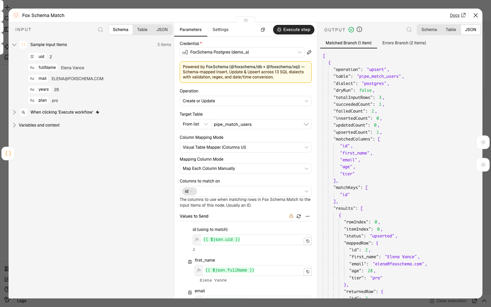
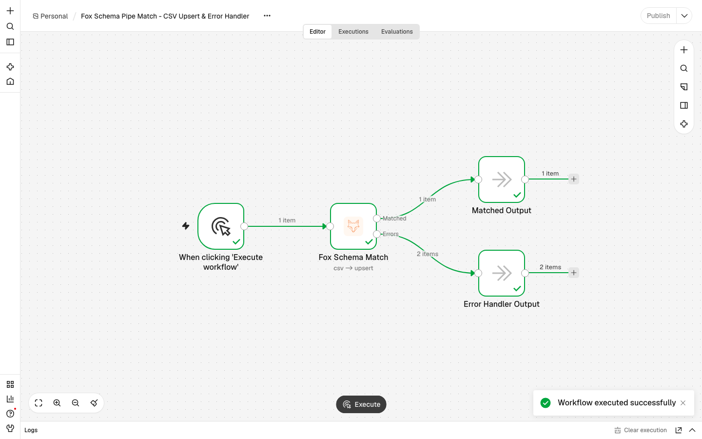

# Fox Schema Match (`n8n-nodes-fox-schema-match`)

Schema-mapped **Insert**, **Update**, and **Create or Update (Upsert)** community node for [n8n](https://n8n.io), powered by [FoxSchema](https://foxschema.com) (`@foxschema/db` + `@foxschema/sql`).

Connect any upstream n8n node, load your database table schema and column types automatically via FoxSchema, map fields manually or automatically with **Data Type enforcement**, **Validation** (`required`, `min`/`max`, `allowedValues`), **Regex** (`validate` / `extract` / `replace`), and **Date/Time conversion** across **13 SQL dialects**, and route row/batch errors cleanly through the built-in **Error Handler**.

---

## Screenshots & Video Demo

- **End-to-end n8n Creator walkthrough video:** [screenshots/fox-schema-match-creator-demo.webm](https://github.com/tedious-code/n8n-nodes-fox-schema-match/raw/main/screenshots/fox-schema-match-creator-demo.webm)
- **Short execution video:** [screenshots/fox-schema-match-demo.webm](https://github.com/tedious-code/n8n-nodes-fox-schema-match/raw/main/screenshots/fox-schema-match-demo.webm)
- **Sample workflow:** [examples/sample-workflow-pipe-match.json](examples/sample-workflow-pipe-match.json)

### Visual Table Mapper (Mapped Database Insert / Update / Upsert)


### Canvas Execution (Matched + Error Handler Branches)


### Error Handler Output (Row-Level Isolation)


---

## Supported Dialects

PostgreSQL, CockroachDB, YugabyteDB, Amazon Redshift, MySQL, MariaDB, TiDB, SQL Server, Azure SQL, Oracle, SQLite, DuckDB, ClickHouse.

> **Note:** Db2 is not supported because native `ibm_db` cannot install via n8n's community node installer.

Drivers stay external so package installation succeeds without native build toolchains. Install only the driver(s) you use on your n8n host (`pg`, `mysql2`, `mssql`, `oracledb`, `better-sqlite3`, `@duckdb/node-api`, `@clickhouse/client`).

---

## Features

### 1. Schema Loading & Column Mapping
- **FoxSchema Catalog Introspection**: Browse target tables and load columns, primary keys, nullability, and data types (`searchTargetTables`, `getTargetColumns`, `getMappingColumns`).
- **Visual Table Mapper (`Columns` UI)** *(default)*: Auto-populates every column of the selected table (`Map Each Column Manually` with drag-and-drop `$json` expressions, or `Map Automatically`) and pre-selects primary keys for `Update` / `Create or Update`.
- **Auto-Match (`auto`)**: Automatically matches incoming `$json` fields using `Exact`, `Case-Insensitive`, or `Normalized` (`firstName` → `first_name`) matching.
- **Manual Field Mapping (`manual`)**: Map nested JSON paths (`user.profile.email`) to target columns with transforms.

### 2. Column Rules (Data Type, Validation, Regex & Date/Time)
Add per-column rules loaded directly from your target table:
- **Data Type Enforcement**: `Auto` (from database schema), `String`, `Integer`, `Decimal / Float`, `Boolean`, `Date`, `Date & Time`, `JSON`.
- **Validation**: `Required`, `Min / Max Value or Length`, `Allowed Values` (comma-separated enum), `Default Value`, `Trim Whitespace`, `Case Transform`, and custom validation error messages.
- **Regex Support**:
  - **Validate Pattern**: Reject non-matching values with `REGEX_VALIDATION`.
  - **Extract Match / Capture Group**: Extract a regex group or token before type coercion.
  - **Find & Replace**: Clean or normalize strings before saving.
- **Date / Time Conversion**:
  - Parse from `Auto-Detect`, `YYYY-MM-DD`, `MM/DD/YYYY`, `DD/MM/YYYY`, `Unix Seconds`, or `Unix Milliseconds`.
  - Convert to `ISO 8601`, `SQL Date (YYYY-MM-DD)`, `SQL DateTime (YYYY-MM-DD HH:mm:ss)`, `SQL Time (HH:mm:ss)`, `Unix Seconds`, or `Unix Milliseconds` in any IANA **Target Timezone** (`UTC`, `America/Chicago`, etc.).

### 3. Write Operations
- **Create or Update (Upsert)**: Dialect-native `ON CONFLICT ... DO UPDATE` (Postgres/Cockroach/Yugabyte/SQLite/DuckDB), `ON DUPLICATE KEY UPDATE` (MySQL/MariaDB/TiDB), `MERGE INTO` (SQL Server/Azure SQL/Oracle), and two-step fallback (Redshift/ClickHouse).
- **Insert**: Chunked multi-row parameterized inserts respecting per-dialect parameter limits (`maxInsertRows`) with optional `Ignore Duplicates on Insert`.
- **Update**: Parameterized `UPDATE ... SET ... WHERE ...` matched on selected or auto-detected key columns, with optional `Require Matched Row on Update`.
- **Dry Run**: Preview compiled SQL and validated rows without mutating the database.

### 4. Error Handler
- **Route Failed Rows to Error Output** *(default)*: Dual outputs (`Matched` at index `0`, `Errors` at index `1`) — isolates failed validation, regex (`REGEX_VALIDATION`), date (`DATE_PARSE_ERROR`), type coercion (`TYPE_COERCION`), or DB constraint rows (including automatic batch-to-row fallback) while valid rows continue succeeding.
- **Rollback Batch & Route to Error Output**: Runs in a database transaction, rolls back on any failure, and emits `TRANSACTION_ABORTED` details to the `Errors` output.
- **Skip Failed Rows & Log in Summary**: Single output combining `results[]` and `errors[]`.
- **Stop Workflow (Throw Error)**: Fails immediately with `NodeOperationError`.

---

## Development

```bash
pnpm install
pnpm build
pnpm test
pnpm validate:n8n
pnpm scan:n8n
```

## Trusted Publishing (OIDC)

`.github/workflows/publish.yml` publishes via npm OIDC Trusted Publishing (`id-token: write`, `environment: npm-publish`, `npm publish --provenance --access public`) on GitHub Releases or manual workflow dispatch.
