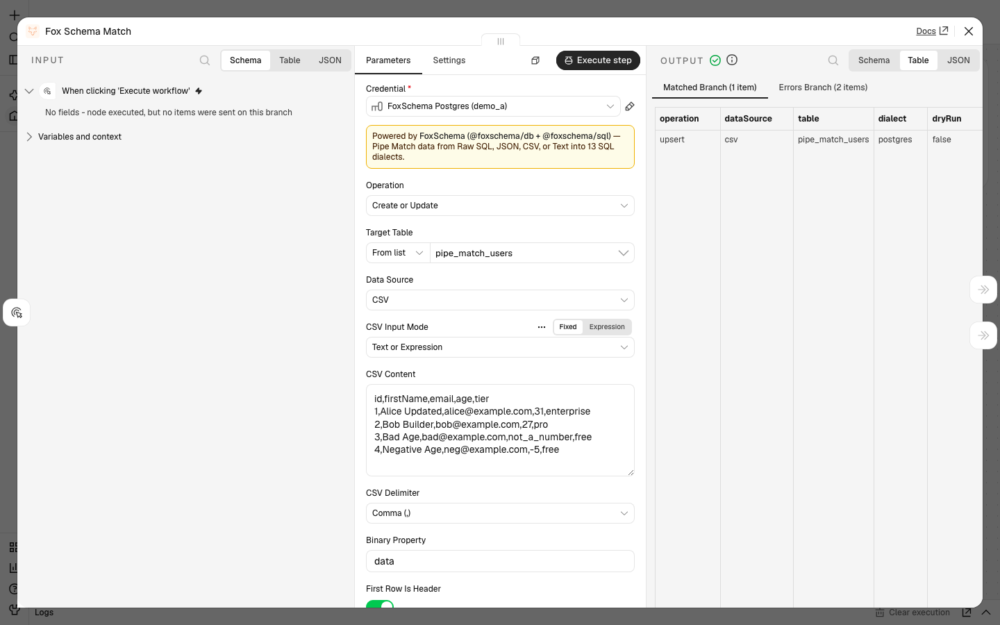
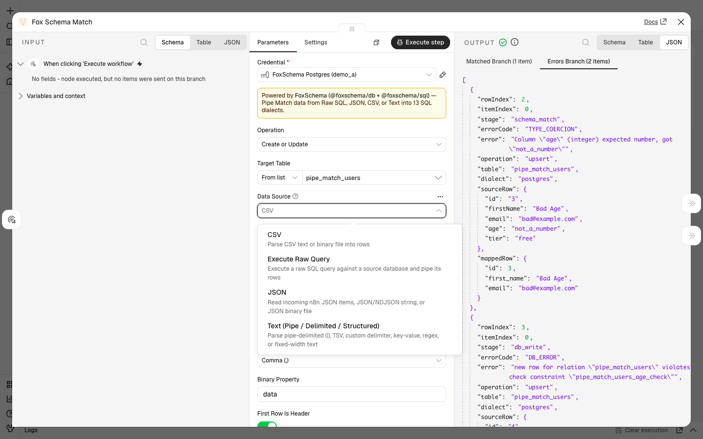
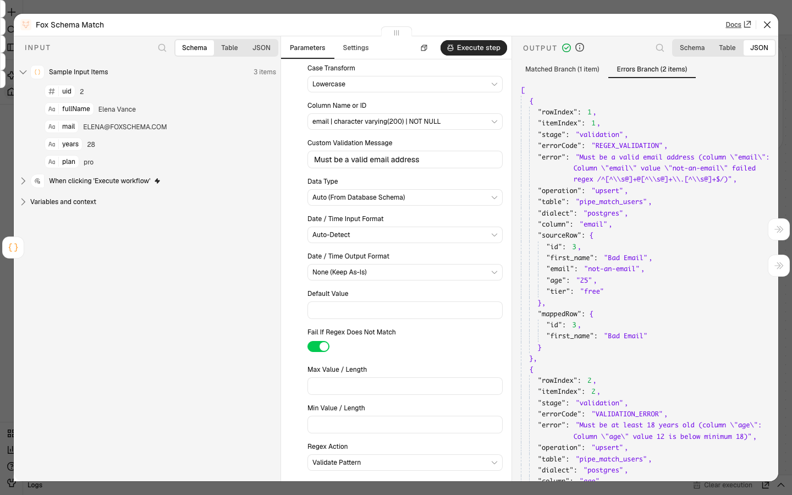
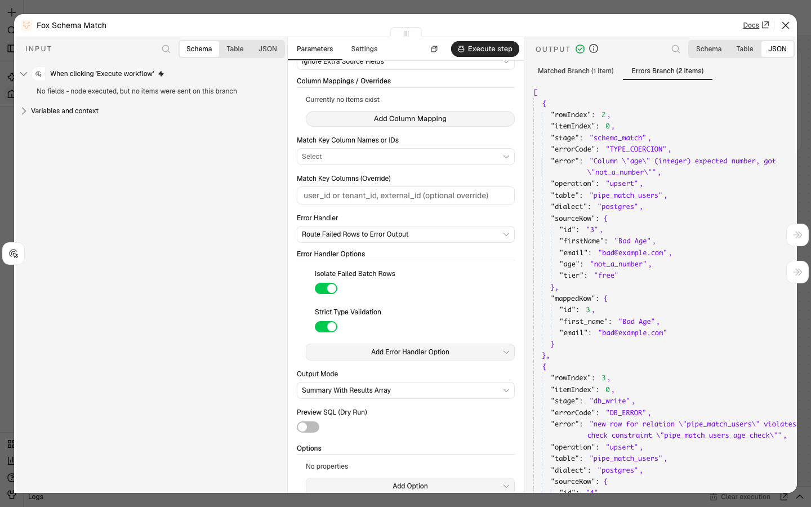

# Fox Schema Match (`n8n-nodes-fox-schema-match`)

**Fox Schema Pipe Match** community node for [n8n](https://n8n.io), powered by [FoxSchema](https://foxschema.com) (`@foxschema/db` + `@foxschema/sql`).

Ingest data from **Execute Raw Query**, **JSON / NDJSON**, **CSV**, or **Text** (pipe-delimited `|`, TSV, custom delimiter, key-value, regex capture groups, fixed-width, raw lines), automatically or manually match fields to target database table columns, coerce types using FoxSchema catalog metadata, execute **Insert**, **Update**, or **Create or Update (Upsert)** across **13 SQL dialects**, and route parse/schema/DB failures through a built-in **Error Handler**.

---

## Screenshots & Video Demo

- **End-to-end Playwright video walkthrough (live n8n + PostgreSQL):** [screenshots/fox-schema-match-demo.webm](https://github.com/tedious-code/n8n-nodes-fox-schema-match/raw/main/screenshots/fox-schema-match-demo.webm)
- **Sample workflow:** [examples/sample-workflow-pipe-match.json](examples/sample-workflow-pipe-match.json)

### Canvas Execution (Matched + Error Handler Branches)


### Visual Table Mapper (Mapped Database Insert / Update / Upsert)


### Node Configuration & Matched Output


### Data Sources (CSV, Execute Raw Query, JSON, Text)


### Error Handler Output (Row-Level Isolation: Type Coercion + DB Constraint)


### Schema Match & Error Handler Parameters


---

## Supported Dialects

PostgreSQL, CockroachDB, YugabyteDB, Amazon Redshift, MySQL, MariaDB, TiDB, SQL Server, Azure SQL, Oracle, SQLite, DuckDB, ClickHouse.

> **Note:** Db2 is not supported because native `ibm_db` cannot install via n8n's community node installer.

Drivers stay external so package installation succeeds without native build toolchains. Install only the driver(s) you use on your n8n host (`pg`, `mysql2`, `mssql`, `oracledb`, `better-sqlite3`, `@duckdb/node-api`, `@clickhouse/client`).

---

## Features

### 1. Data Sources
- **Execute Raw Query**: Run parameterized SQL (`?` placeholders rewritten per dialect) against the target DB credential or an inline cross-dialect source connection, with optional `rawQueryDataPath` extraction.
- **JSON**: Read incoming workflow `$json` items, JSON / NDJSON strings or expressions, or binary `.json` / `.ndjson` files with optional dot/bracket `jsonRootPath`.
- **CSV**: RFC-4180 parser with custom delimiters (`,`, `;`, `\t`, `|`, custom), quoted fields, multiline values, BOM stripping, headerless custom columns, and binary file support.
- **Text**: Pipe-delimited (`|`), TSV (`\t`), custom delimiters, `key=value` pairs, regex named/numbered capture groups, fixed-width column specs (`col:start-end` or `col:width`), and raw lines.

### 2. Pipe Match & Coercion
- **FoxSchema Catalog Introspection**: Browse target tables and columns (`searchTargetTables`, `getTargetColumns`, `getMappingColumns`) and auto-detect primary/unique keys.
- **Mapping Modes**:
  - **Visual Table Mapper (Columns UI)**: Uses n8n's native `resourceMapper` to auto-populate every column of the selected table (`Map Each Column Manually` with drag-and-drop `$json` expressions or `$row.<field>` templates for CSV/Text/Raw Query, or `Map Automatically`).
  - **Auto-Match**: Exact, Case-Insensitive, or Normalized (`firstName` / `first-name` / `FIRST_NAME` → `first_name`), with optional per-column overrides and transforms.
  - **Manual Column Mapping**: Map source paths (`user.email`) to target columns with defaults and transforms (`trim`, `lowercase`, `uppercase`, `toNumber`, `toBoolean`, `toIsoDate`, `jsonStringify`, `nullIfEmpty`).
  - **Positional**: Map ordered fields by column index.

### 3. Write Operations
- **Create or Update (Upsert)**: Dialect-native `ON CONFLICT ... DO UPDATE` (Postgres/Cockroach/Yugabyte/SQLite/DuckDB), `ON DUPLICATE KEY UPDATE` (MySQL/MariaDB/TiDB), `MERGE INTO` (SQL Server/Azure SQL/Oracle), and two-step fallback (Redshift/ClickHouse).
- **Insert**: Chunked multi-row parameterized inserts respecting per-dialect parameter limits (`maxInsertRows`) with optional duplicate ignore.
- **Update**: Parameterized `UPDATE ... SET ... WHERE ...` matched on selected or auto-detected key columns, with optional `requireMatchedRow`.
- **Dry Run**: Preview compiled SQL and matched rows without mutating the database.

### 4. Error Handler
- **Route Failed Rows to Error Output** *(default)*: Dual outputs (`Matched` at index `0`, `Errors` at index `1`) — isolates failed parse, schema mismatch, type coercion, missing key, or DB constraint rows (including automatic batch-to-row fallback) while valid rows continue succeeding.
- **Rollback Batch & Route to Error Output**: Runs in a database transaction, rolls back on any error, and emits `TRANSACTION_ABORTED` details to the `Errors` output.
- **Skip Failed Rows & Log in Summary**: Single output combining `results[]` and `errors[]`.
- **Stop Workflow (Throw Error)**: Fails immediately with `NodeOperationError`.

---

## Development

```bash
pnpm install
pnpm build
pnpm test
pnpm validate:n8n
pnpm scan:n8n
```

## Trusted Publishing (OIDC)

`.github/workflows/publish.yml` publishes via npm OIDC Trusted Publishing (`id-token: write`, `environment: npm-publish`, `npm publish --provenance --access public`) on GitHub Releases or manual workflow dispatch.
